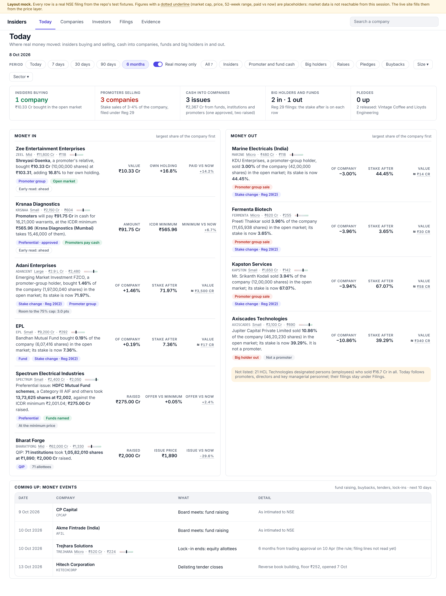
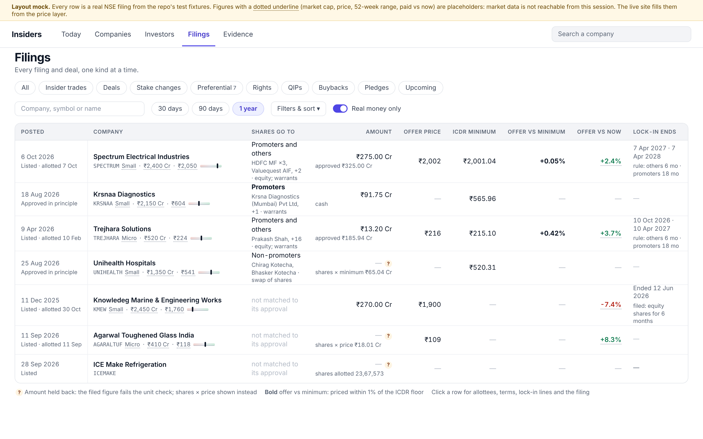
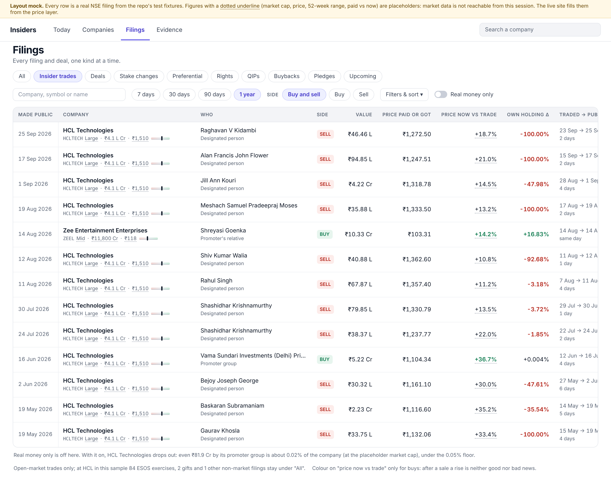
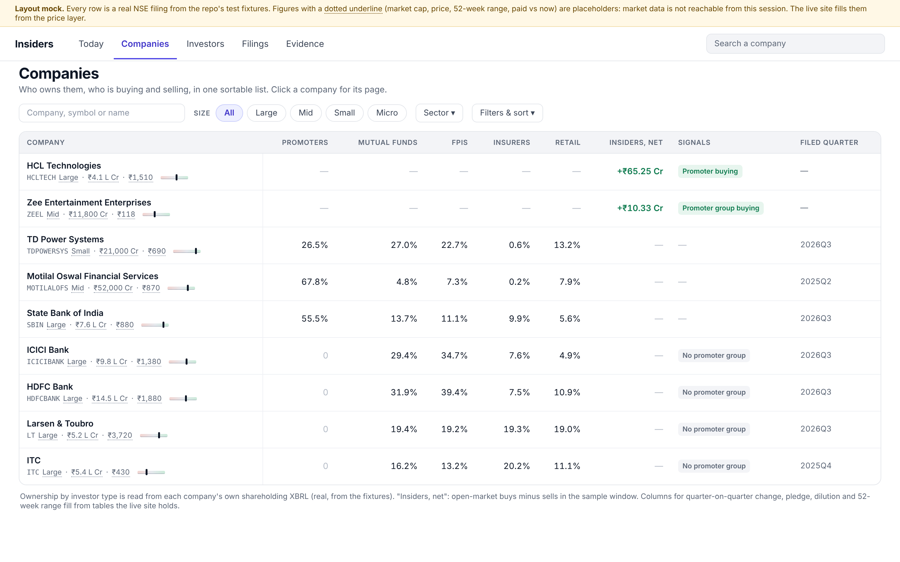
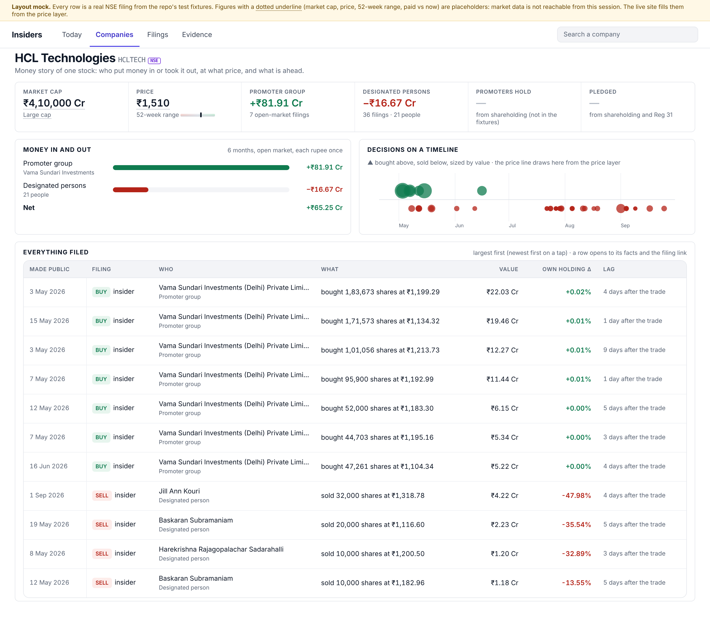
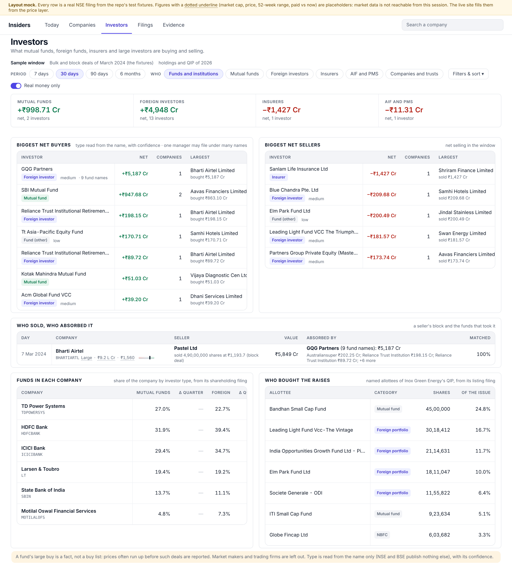
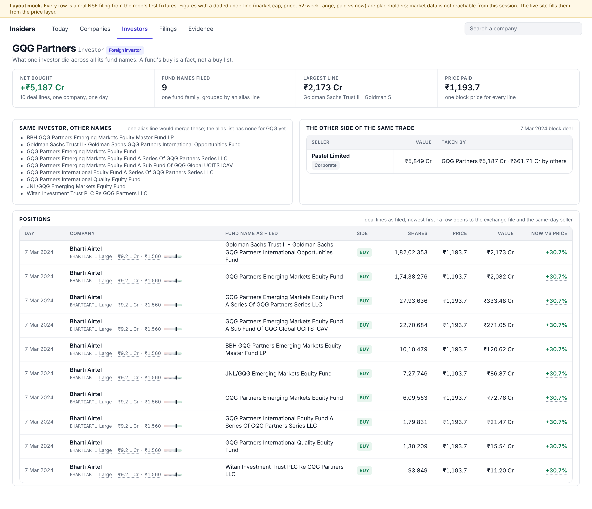

# Design V3: the money board (owner brief of 23 Oct 2026)

Why: the 21-22 Oct redesign made the site clean by moving information behind a click. The owner's
brief: show where **real money** is moving (insider trades, large trades, capital raised, funds and
big holders in and out), not splits, bonuses or dividends; neat and clean, yet all the information;
think as a small individual investor. Inputs: `docs/DATA_INVENTORY.md` (what we collect) and the
old-vs-new comparison of 23 Oct.

Images in `docs/design_v3/` (eight of them) are layout mocks built with the site's own CSS and cell helpers. Every
row is a real NSE filing or deal from `tests/fixtures/`. Cells with a dotted underline (market cap, price,
52-week range, price now vs trade) are **placeholders**: market data is not reachable from the
session that made them. The live Site preview run fills them from the price layer. Rebuild with
`docs/design_v3/mock/` (`build_mocks.py`, then `shoot.py`).

## Build status

| Step | State |
|---|---|
| Filings kinds: pills and a table of its own columns for Insider trades, Deals, Stake changes, Preferential, Rights, QIPs, Buybacks, Pledges and Upcoming; company cell with size, market cap, price and 52-week bar; "?" for a held-back amount; lock-in end dates; Upcoming (fund-raising and buyback meetings, tender closes, lock-in ends, next 60 days) | **Built 23 Oct** (`screens/filings_all.py`, `ui/table.py`; tests in `tests/test_filings_page.py`) |
| Today as the money board: Money in / Money out / Risk changes panels, the ₹25 Cr rule, Raises, Coming up, market line on rows (`insiders_clean/ideas.py`, `screens/home.py`) | **Built 23 Oct** (rules below) |
| Investors page v1 (net buyers and sellers, by manager, who absorbed, funds in each company, who bought the raises); investor profile later | Built 23 Oct |
| Companies list and the dossier's ratios strip, decisions timeline | After Investors |
| Company snapshot table (market line, promoter %, pledge %, funds' and FPIs' change, insider flows) in the nightly precompute | **Coded 23 Oct** (`insiders_clean/snapshot.py`); first nightly writes it; no page reads it yet |

Not built yet: a "Real money only" switch on Filings, the investor profile page, and the headline sentence per Filings row.

## Rules for Today, agreed 23 Oct (owner, with the consultant's review)

- **₹25 Cr path**: one decision-maker (a promoter group counts once) buying or selling ₹25 Cr or more on one side in the period qualifies
  whatever its share of the company. Decision-makers are promoters, promoter group, directors and KMP; designated persons and
  employees never count. Sales are open-market only (ESOP, gifts, pledge invocation and OFS are excluded upstream). A promoter group
  selling uses the same floors as buying; a director or KMP selling counts only at ₹25 Cr and up. Gross per side, not netted: a
  decision-maker who both bought and sold in the period shows in both lists, each row's facts name the other side.
- **Order inside a group**: rows at ₹25 Cr or more go first by value, at most five of the eight shown, so at least three places stay
  for the rows ranked by share of the company. A "₹25 Cr+" chip marks them.
- **Raises** (own neutral group under Money in; never a verdict): QIPs, preferential issues to non-promoters or mixed, rights issues,
  allotted or listed only (an approval is not a raise), dated by allotment. Shown at ₹100 Cr and up, or 2% and up of the shares
  outstanding. The base is the shareholding table's total, and only when the new shares are under half of it; otherwise the row says
  "dilution not stated". A raise with neither a usable amount nor a usable dilution is not listed. Promoter issues stay with
  "Promoters pay up" (price at or above the market price; exactly equal counts as paying up) and "Cheap shares to promoters"
  (below), so each lands in exactly one place.
- **Panels**: Money in (insiders buying, promoters pay up, big investors and funds in, buybacks at a premium, raises), Money out
  (insiders selling, big investors and funds out), Risk changes (pledges up, pledges released, cheap shares to promoters). Internal
  list codes `look` and `warn` are unchanged, so the track record and the company page are untouched.
- **Coming up**: board meetings that consider fund raising or a buyback, tender closes, lock-ins ending, next ten days. A meeting is
  not a raise until its outcome is filed.

## The investor's question

Who put real money in or took it out, how big is that for the company, at what price compared with
today, and what is the catch? Every row answers those four, in that order.

## What counts as real money

| Real money | The number that matters | Direction |
|---|---|---|
| Promoter and director open-market buys | ₹ and % of the company, own-holding change, paid vs now | In |
| Promoters paying cash into the company (preferential shares, warrants) | Offer price vs ICDR minimum and vs market; dilution % | In |
| Open-market sales by promoters and insiders | ₹, % of the company, % of own holding | Out |
| Funds in and out (bulk and block deals, market makers excluded) | Net ₹ and % of the company, who | Either |
| Outside holders crossing 5% or moving 2% (SAST) | % moved, stake after, who | Either |
| Raising money from outsiders (QIP, rights, preferential to non-promoters) | Price vs market, discount, who bought, dilution | Dilution, or institutions' vote |
| Funds' and FPIs' quarterly holding change (shareholding XBRL, collected, not shown today) | Change in points of the company, quarter on quarter | Either |
| Pledges | Pledge % and its change, lender, invocation | Out (risk) |
| Buybacks | Tender premium to market, size as % of the company | In |
| Lock-in expiries | Date, shares, value at market | Future supply |

## Left out of the front pages

- Splits, bonuses, dividends: no cash moves. Kept inside the price layer only, to adjust prices.
- ESOS exercises, gifts, inter-se transfers inside a promoter group, schemes, intraday round trips,
  token buys, market makers, companies under ₹100 Cr (the clean layer already marks them).
- Board meetings and results as feed rows: a meeting appears under "Coming up" only when it is about
  fund raising or a buyback; results are context on the company page.
- A standalone corporate-actions kind: only buybacks and rights remain, as money items.
- Announcement cards: off the site (owner, 21 Oct).
- Held-back rows and copies stay in Filings under "All", for audit.

## The five pages

Top bar: Today, Companies, Investors, Filings, Evidence, and a company search. A single investor's page opens
from links; Data quality in the footer. (Investors added 23 Oct after the owner asked where funds, PMS and
large investors can be seen; before that no page answered it: the old Bulk & block deals page was folded
into Filings and People & funds is link-only.)

### Today: the money board

- Period chips, "Real money only" (on by default), group pills, tiles with counts and rupees by
  type. Types are never added into one score (no star score, owner 07 Oct).
- **Money in** and **Money out**: one row per company, largest share of the company first. A row:
  company cell, one sentence built from fields only, chips (who, kind, evidence tag), three numbers.
- **Coming up: money events**: fund-raising and buyback board meetings, tender windows, lock-in
  expiries (rule or filed lines, labelled).
- Left-out note under the lists says what "Real money only" removed and why.

Phone: the same rows as cards (`06_today_phone.png`).

### Filings: one kind at a time, each kind with its own columns

Kind pills: All, Insider trades, Deals, Stake changes, Preferential, Rights, QIPs, Buybacks, Pledges,
Upcoming. "All" stays the 7-column mixed feed. Row specs (at most nine numbers, in this order):

| Kind | Columns |
|---|---|
| Insider trades | Made public · Company cell · Who and role · Side · Value · Price · Price now vs trade · Own holding Δ · Traded → public · Flags |
| Preferential | Posted and stage · Company cell · Shares go to (and instruments) · Amount · Offer price · ICDR minimum · Offer vs minimum · Offer vs now · Lock-in ends |
| QIPs | Posted · Company cell · Allottees (count, named funds) · Amount · Issue price · Floor · Discount · Issue vs now |
| Rights | Posted · Company cell · Ratio · Rights price · Rights vs now · Record date · Closes · Amount |
| Stake changes | Day · Company cell · Who and type · Side · % moved · Stake after · Mode · Promoter |
| Deals | Date · Company cell · Client and type · Side · Value · % of company · Price vs now · Counterparty |
| Buybacks | Company cell · Route · Offer price · Premium to market · Size · Opens · Closes |
| Pledges | Day · Company cell · Promoter · Lender · Event (created, released, invoked) · % of company · Pledge % after |
| Upcoming | Date · Company cell · What (meeting, tender, lock-in) · Detail |

A row opens in place to allottees, terms, lock-in lines and the filing link. No CSV export (owner, 22 Oct).

### Companies: a list to screen, a dossier to decide

- The list: company cell, promoters, mutual funds, FPIs, insurers, retail (from each company's own
  shareholding XBRL), insiders' net money, signals. Next columns, from tables the site holds: change
  since last quarter, pledge %, dilution over 12 months, 52-week position.
- The dossier: a ratios strip, **Money in and out** by who, **Decisions on a timeline** (the price
  line draws under the dots), then everything filed, a row opens to its facts.

### Investors: what funds and large investors are buying and selling

- Period chips and a Who filter: Funds and institutions (default), Mutual funds, Foreign investors,
  Insurers, AIF and PMS, Companies and trusts. Market makers and trading firms are left out.
- Tiles: net money by investor type.
- **Biggest net buyers** and **net sellers**: investor with its type and confidence, net ₹, companies,
  largest position. One manager that files under many fund names is shown once (needs an alias line:
  the list has none for GQG yet; the mock groups ten names of GQG Partners as proposed).
- **Who sold, who absorbed it**: a seller's block and the funds that took it, matched. Real example in
  the mock: Pastel Ltd's ₹5,849 Cr block of Bharti Airtel on 7 Mar 2024, taken 100% by GQG Partners
  (₹5,187 Cr, nine fund names) and others.
- **Funds in each company**: share held by mutual funds and foreign portfolio investors from the
  shareholding filing, with the change since the previous quarter (needs two quarters; the fixtures hold
  one, so the live site fills it).
- **Who bought the raises**: named allottees of QIPs and preferential issues with their category.
- The investor page: net, fund names filed, each deal line as filed, and the other side of the same trade.
- Limits to show on the page: type comes from the name only (NSE and BSE publish nothing else), so
  AIF and PMS cannot be told apart and a name can be wrong (confidence is shown); bulk and block deals
  are a 0.5%-and-up, large-trade view, not every holding; the quarterly change lags by weeks.

### Evidence: unchanged.

## Shared pieces

1. **Company cell**: name, then one muted line: symbol · size · market cap · price · 52-week bar.
   About 300 px wide on desktop. The exchange tag shows only for BSE-only companies.
2. **Headline sentence**: built from fields only (never a model), active voice, the number in it:
   "Shreyasi Goenka, a promoter's relative, bought ₹10.33 Cr (10,00,000 shares) at ₹103.31, adding
   16.8% to her own holding." Every number in it is a column of the row.
3. **Signed numbers**: green and red only for buy and sell. After a sale, "price now vs trade" is
   not coloured: a rise is neither good nor bad news.
4. **Chips**: at most two tags plus an evidence tag; extra ones fold into "+N".
5. **Number hygiene**: a figure that fails its unit check shows "—" with a "?" and the reason on
   hover, plus the safe alternative (shares × price). Example from the old Capital raises page:
   ICE Make's amount of ₹1,90,00,010 Cr; Unihealth's and Agarwal Toughened Glass's filed amounts are
   exactly 1 lakh times shares × price (checked on the fixtures). Never hide an empty column: "—" says the data is not filed.
6. **Real money only** (on by default) uses the ideas rules unchanged (`insiders_clean/ideas.py`):
   per decision-maker ₹25 L and 0.05% of the company, or 0.25% alone, or buying on 10 or more days;
   funds 0.25% net; SAST 5% and 2%; tender buybacks at a 10% premium or more.

## What the mocks showed

- **Feasible with what we have.** All six images use `ui/insiders.css`, `ui/table.css` and `ui/kit.py`
  helpers. New work is the company cell width and a compact market-cap format, the headline builder,
  the kind-specific columns, the ratios strip, the decisions timeline and the Upcoming kind.
- **Finding: the real-money rule hides HCL Technologies' promoter group.** It bought ₹81.9 Cr in 7
  filings, about 0.02% of the company at the placeholder market cap, under the 0.05% floor, so Today
  with "Real money only" on does not show it (Filings with it off does). Decision for the owner below.
- **Real quirks the page must cope with**: three of the seven preferential rows carry an amount that fails the
  unit check (two checked: exactly 1 lakh times shares × price), shown as "?"; a listing record not matched to its approval has no
  allottees or minimum price; a filing can contradict itself (HCL: a "Market Purchase" that is a
  disposal), which the mock left out and the clean layer marks.

## Requirements before building

- **A company snapshot table** from the nightly precompute: symbol, market cap, price, 52-week range
  and position, size bucket, promoter %, pledge %, last insider buy, funds' and FPIs' change. Every
  page joins only that (Streamlit Cloud memory).
- Tables draw at most about 150 rows with paging; filters live in the page address so a saved screen
  is a bookmark.
- Institutions' quarter-on-quarter change and dilution % are new derived columns in the clean layer.

## Open decisions (owner)

1. ~~Real money for a large company~~ **Decided 23 Oct (owner): yes, "or ₹25 Cr and up by one decision-maker" is an
   additional path** (a ₹82 Cr promoter-group purchase in a ₹4 lakh Cr company then shows). Applies to the
   ideas rules in `insiders_clean/ideas.py`; tests to follow with the change.
2. Funds' and FPIs' quarterly change: now on Investors and the dossier; on Today too?
3. Build order: Filings kinds first (largest gap), then Today, Companies, the dossier.

## Out of scope for this document

Colour and type values stay as in `docs/DESIGN.md`. Wording, data collection and the track record
are unchanged.
